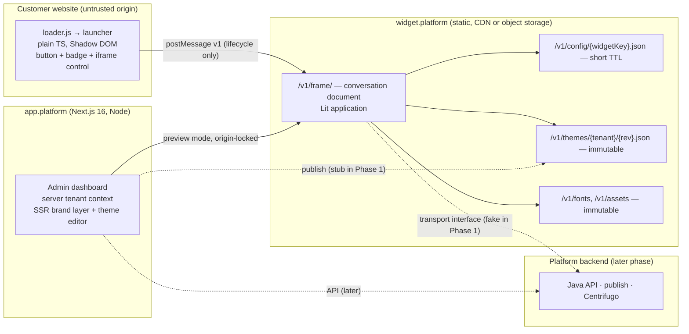

# ARCHITECTURE-001 — SaaS Frontend Foundation Baseline

**Document ID:** ARCH-001
**Version:** 0.3 — *baseline candidate for approval*
**Date:** 6 November 2026
**Supersedes:** ARCH-001 v0.2 (review draft) and incorporates ADR-007 (Proposed)
**Inputs:** ARCH-001 v0.1 brief · three independent reviews · ARCH-001 v0.2 consolidated draft · ADR-007 *Widget Conversation Isolation* (Proposed) · product-owner decision PO-010 (conversation confidentiality)
**Status:** Not yet approved. Section 20 lists what must be accepted before `create-nx-workspace` runs.
**Intended path:** `docs/architecture/ARCHITECTURE-001-saas-frontend-foundation.md` (v0.1, v0.2 and the review reports stay under `docs/architecture/reviews/` unchanged)

> **What this document is.** The implementable baseline for the frontend foundation. It keeps every confirmed product decision from v0.2, resolves the technical questions v0.2 left open wherever a defensible default exists, and changes v0.2/ADR-007 only where Section 2 gives the reason. Everything an engineer or AI agent needs to start P1.0 is here: workspace layout, project boundaries and tags, contract field lists, the bridge protocol, CSP requirements, caching rules, gates and milestones.
>
> **What it is not.** Not an implementation authorisation (Section 20), not application code, and not a substitute for the two PoCs it requires.

**Decision vocabulary** (unchanged from v0.2): **Confirmed requirement** (product owner decided) · **Baseline decision** (this document decides; recorded in an ADR; changeable only by superseding the ADR) · **PoC-gated** (baseline decision that becomes *Accepted* only after the named PoC passes) · **Open** (needs product-owner input; a default is stated so work is not blocked) · **Deferred**.

---

## 1. Executive summary

v0.2 is a sound consolidation and ADR-007 makes the right call: **the conversation surface runs in a cross-origin iframe on a platform-controlled origin; a small launcher runs in the customer's page.** This baseline keeps that decision and builds the rest of the foundation around it.

Following the iframe decision to its conclusions changes several things v0.2 and ADR-007 still carry over from the Shadow-DOM-era design. The most important corrections (full register in Section 2):

1. **The host page must not be a source of theme for the confidential frame.** ADR-007's "constrained theme handoff" over `postMessage` lets untrusted page scripts influence the trusted surface. The frame fetches its own published theme from the platform origin. The only host→frame visual input is the dashboard's *preview mode*, locked to the dashboard origin. (Section 10.4)
2. **The launcher should be framework-free TypeScript, not Lit.** Its job is a button, a badge and an iframe. Removing Lit from the host page removes the `trusted-types lit-html` requirement for customers who enforce Trusted Types, saves roughly the Lit runtime on every customer page, and leaves no `innerHTML` in the host document. Lit remains the framework for the frame application. (Section 10.2)
3. **Customer CSP shrinks to two directives.** With (1) and (2), the host page needs only `script-src` and `frame-src` for the widget origin — no `connect-src`, `style-src`, `font-src` or Trusted Types policy. This is a genuine embedding advantage and a PoC acceptance criterion. (Section 10.7)
4. **The frame document is a deployable that v0.2's workspace lacks.** Day one gets `apps/widget` (loader + launcher + frame document, one Vite build with three entries) alongside `admin-dashboard` and `widget-playground`. (Section 6)
5. **The frame lifecycle is undefined in both documents.** Proactive greetings and unread badges require the frame to exist before the visitor opens it. Baseline: create the frame hidden after the launcher paints and the page is idle; the PoC measures the cost. (Section 10.3)
6. **Tenant theming of the agent dashboard's own chrome is challenged.** The *contract* stays shared (same tokens, same resolver, dashboard preview renders the real frame), but applying a tenant's brand palette to the agent inbox is a usability and contrast risk the product may not want. Default: dashboard applies logo + accent only. This narrows PO-006 and needs the product owner's confirmation. (Open Q-013)
7. **Remaining technical choices are decided with defaults:** Nx workspaces + TypeScript project-references setup, Node 24 LTS, pnpm 11 with a 7-day release cooldown, TypeBox (0.34 LTS line) as the single schema source with Zod 4 as the recorded fallback, Base UI as the preferred primitive pending its PoC, Storybook 10 with the Vitest addon, Playwright, WCAG 2.2 AA.

**Readiness:** this document is ready for architecture approval of ADR-001, 002, 003, 008, 009, 010 and 011. ADR-004, 005 and 006 are ready to accept after the small PoCs in Section 17 confirm tooling behaviour. ADR-007 is PoC-gated and is the first engineering work after P1.1.

---

## 2. Review of v0.2 and ADR-007 — challenges and dispositions

Each row names the source text, the problem, and what this baseline does about it. **Change** = this document alters the v0.2/ADR-007 position; **Add** = a gap is filled; **Keep** = confirmed; **PO** = needs the product owner.

| # | Source | Challenge | Disposition → where |
|---|---|---|---|
| CH-01 | ADR-007 §Protocol "constrained theme handoff"; v0.2 §5.3, §7.6 step 5 | The host page (untrusted) must not supply theme data to the confidential frame. Theme over the bridge re-opens a host→frame influence channel the iframe was adopted to close, and forces the launcher to fetch (needs `connect-src`). | **Change** — frame fetches theme directly from the platform origin by `widgetKey`; host→frame theme allowed only in dashboard preview mode, origin-locked → §10.4, §8.6 |
| CH-02 | v0.2 §5.2, ADR-007 Option B | Frame lifecycle unspecified: created at load or on first open? Proactive messages and unread badges need a live frame. | **Add** — create hidden after launcher paint + idle; PoC measures cost; proactive messaging requirement → §10.3, Q-015 |
| CH-03 | v0.2 §9 "Lit remains the framework for the host launcher" | Launcher is tiny; Lit on the host page costs the Lit runtime and requires customers enforcing Trusted Types to allowlist `lit-html`. A framework-free launcher with no `innerHTML` needs no Trusted Types policy. | **Change** — launcher = plain TypeScript with Shadow DOM + adopted stylesheets; Lit for the frame app → §10.2 |
| CH-04 | v0.2 §9 "register a versioned, namespaced custom element" | Registration is only needed for a declarative `<tag>` API. Default embed is a script snippet; mount imperatively; define `acme-chat-v1` only as an optional declarative API, guarded. | **Change (minor)** → §10.2 |
| CH-05 | v0.2 PO-006 "one tenant-wide theme shared by dashboard and widget" | Applying a tenant's palette to the agent dashboard chrome creates contrast/usability risk across two very different UIs and doubles SSR theming scope. The *contract* should be shared; the *application* to dashboard chrome should be narrow (logo, accent) or none. | **PO** — default: shared contract, dashboard applies brand layer only; SSR path retained → §9.2, Q-013 |
| CH-06 | ADR-007, v0.2 §5 | Frame document's own headers absent: `Content-Security-Policy` (incl. `frame-ancestors`), `Referrer-Policy`, `Permissions-Policy`, `Cross-Origin-Opener-Policy`. Tenant domain allowlist not discussed. | **Add** → §10.7; **PO** Q-014 |
| CH-07 | ADR-007 "use an exact targetOrigin" | How the frame learns the parent origin is unspecified. `location.ancestorOrigins` is unavailable in Firefox before 148. | **Add** — URL param + `ancestorOrigins` where present + first-message verification → §10.5 |
| CH-08 | v0.2 §5.5 (5), §12 CSP row | Customer CSP requirements left to "the implementation". With CH-01/CH-03 they can be fixed now: `script-src` + `frame-src` only. | **Add** → §10.7, Appendix C |
| CH-09 | v0.2 §7.6 step 4 "validate schema version and all values" in the widget | Full schema validation in the frame is unnecessary: the frame fetches *platform-published, already-validated* revisions from its own origin. Version + shape check suffices; keeps the validator out of the widget bundle. | **Change** → §8.5 |
| CH-10 | v0.2 §6.1 workspace | No deployable for the frame document or the loader; `chat-widget` is a library. | **Add** — `apps/widget` (multi-entry Vite) → §6 |
| CH-11 | v0.2 Q-010 Zod vs TypeBox | Decide with a fallback rather than leave open: the JSON Schema *is* the cross-language contract, so a schema-first tool avoids a translation step the backend cannot see. | **Baseline decision** — TypeBox 0.34 LTS (1.x when TypeScript 7 is adopted); Zod 4 fallback (its `toJSONSchema` targets 2020-12) → §8.3 |
| CH-12 | v0.2 §6, PO-004 | Nx linking style unspecified (path aliases vs package-manager workspaces + project references). | **Baseline decision** — workspaces + TS project references → §6.4 |
| CH-13 | v0.2 §17 ADR-001 | Node/pnpm baseline unspecified. | **Baseline decision** — Node 24 LTS, pnpm 11 → §6.5 |
| CH-14 | v0.2 §6.3 "tag names recorded after graph generated" | Tags shape every generator call; decide before generating. | **Add** → §6.3 |
| CH-15 | v0.2 §6.2 e2e placement | Use the `@nx/playwright` default project for the dashboard (free); widget scenarios live in the playground. | **Baseline decision** → §6.1 |
| CH-16 | ADR-007 PoC criteria | Local PoC is only real if playground and frame run on *different origins* (different ports count). | **Add** → §17.1 |
| CH-17 | Review report vs v0.2 ADR numbers | The independent review proposed ADR-012…016; v0.2 renumbered. | **Keep v0.2 numbering**; mapping in §18 |
| CH-18 | ADR-007 "never send visitor PII to the parent" (frame→host) | Host→frame visitor identification (`identify`) is a standard product feature and carries PII *supplied by the tenant's own page*. Allowed, but untrusted until signed identity verification exists. | **Add** → §10.5, later ADR |
| CH-19 | v0.2 §7.4 lifecycle "Draft → Preview" | Preview mechanism undefined. | **Add** — frame `mode=preview` accepts theme messages only from the dashboard origin → §8.6 |
| CH-20 | v0.1/v0.2 "tenant-specific fonts" | Inside the frame document `@font-face` works normally (the Shadow-DOM font limitation no longer applies). Launcher uses the system font stack. | **Add** → §8.4, §10.2 |
| CH-21 | v0.2 §12 storage row, Q-006 | Frame-origin storage is partitioned per top-level site by browsers (Chrome 115+; Firefox/Safari partition too), so continuity is per tenant site — which is what we want. Consent must arrive as a bridge signal because the tenant's consent tool cannot see the frame. | **Add** → §10.6 |
| CH-22 | v0.2 (absent) | i18n/RTL readiness: `lang`/`dir` on the frame, logical properties, `Intl`. | **Add** → §10.8 |
| CH-23 | v0.2 (absent) | Transport abstraction so the future Centrifugo client slots in without touching UI. | **Add** → §10.9 |
| CH-24 | v0.2 ADR-009 "WCAG target" | Make it explicit: WCAG 2.2 AA. | **Baseline decision** → §14 |
| CH-25 | v0.2 §14.3 agent change controls | Controls are stated as rules only; add the mechanical CI checks that enforce them. | **Add** → §15.3 |
| CH-26 | ADR-007 "protocol version negotiation" | Simplify: `v: 1` envelope + `/v1/` paths; the loader loads the major it was built for; no runtime negotiation. | **Change (simplify)** → §10.5 |
| CH-27 | ADR-007 "minimum iframe sandbox" | Specify it. | **Add** → §10.7 |
| CH-28 | ADR-007 PoC (6) mobile | Name the known failure modes: fixed-position frame + iOS keyboard, `100vh`; test with `visualViewport` and `dvh`. | **Add** → §17.1 |
| CH-29 | v0.2 §7.5 "exact Next.js cache APIs must be verified" | Decide the Phase-1 posture instead: Cache Components **off**; all authenticated routes dynamic; `"use cache"` introduced only with the tenant-key lint rule and isolation test. | **Baseline decision** → §9.3 |
| CH-30 | v0.2 §13.1 "widget host integration tests" | Observability for the launcher: it has no network (CH-08); failures are `console.warn` + a status attribute; frame reports via its own origin. | **Add** → §10.10 |

Everything in v0.2 not listed above is **kept**: product scope and exclusions, Phase-1 principles, token layers, theme grammar rules, tenant-context rules, state ownership, two independent Storybooks, three-gate AI-DLC, the risk register, and the stance that no technology is accepted because it is popular.

---

## 3. Product context, confirmed requirements and scope

### 3.1 Confirmed product-owner requirements (carried from v0.2)

| ID | Requirement | Baseline implication |
|---|---|---|
| PO-001 | Multi-tenant SaaS customer-support / live-chat platform. | — |
| PO-002 | Start from an empty folder and empty Git repository. | §19 sequence. |
| PO-003 | Phase 1 = frontend foundation; no backend, DB or production infra. | Static stubs stand in for the config/theme endpoints (§8.7). |
| PO-004 | Nx integrated monorepo + pnpm workspaces. | ADR-001; style decided in §6.4. |
| PO-005 | Next.js App Router dashboard; Lit Web Components widget. | Lit applies to the **frame application**; the launcher is framework-free (CH-03). |
| PO-006 | One tenant-wide theme shared by dashboard and widget. | Shared **contract** confirmed; scope of application to dashboard chrome is Q-013 (CH-05). |
| PO-007 | Tenant theming covers branding, semantic colours, typography, radius, shadows, density within approved limits. | Field list in Appendix B. |
| PO-008 | Dashboard theme resolved and applied during SSR. | §9.2; scope per Q-013. |
| PO-009 | Widget starts from a safe embedded default, loads the published theme at runtime; public bootstrap allowed. | §10.4; bootstrap carries identity/behaviour only. |
| PO-010 | **Conversation content must be confidential from JavaScript on the tenant's host page.** | Cross-origin frame (ADR-007); all of §10. |
| PO-011 | Storybook for React and Lit. | §12. |
| PO-012 | Human approval + automated validation around AI-assisted development. | §15. |
| PO-013 | No Nx Cloud initially; local caching first. | §6.5 (remote cache decision deferred to P1.7). |

Known constraints taken into account: a 3–4 developer team working with AI coding agents (Claude Code, Codex); GitHub + GitHub Actions; a future Java/Spring Boot backend; Centrifugo for realtime; Valkey and S3-compatible object storage in the platform; OpenSpec for specifications; first customers in Australia and the EU; repository private until launch, open source afterwards.

### 3.2 Phase 1 scope

**In scope:** workspace foundation · tokens · theme contract and resolver · React UI foundation (shadcn + primitive PoC) · widget loader, launcher, frame shell and bridge (isolation PoC) · dashboard SSR theme and tenant-context stub · two Storybooks · quality gates · AI-DLC working agreement · ADRs and developer onboarding.

**Out of scope (unchanged):** messaging/conversation workflows, routing, realtime infrastructure, backend services, database/Flyway, production auth (beyond the integration contract + dev adapter), billing, production infrastructure, full dashboard features, client portal.

### 3.3 Phase 1 success definition (measurable)

Phase 1 is complete when every item in the exit checklist (§14.4) is green in CI and the approval record (§20) is signed. The checklist replaces the prose definitions in v0.1/v0.2.

---

## 4. Architecture principles

1. **Architecture before scaffolding; contracts before components; validation before expansion; human approval before AI implementation.**
2. **Confidentiality by origin boundary.** Conversation content lives in a document on a platform-controlled origin. Nothing on the host page renders, caches or receives it.
3. **The host page is untrusted input.** Anything it can send to the frame is validated like a public API request and can never change what the frame *shows* beyond open/close/locale/consent/identity.
4. **One contract, two adapters.** Tokens, theme schema and resolver are framework-neutral; React and Lit consume a resolved variable map, never raw tenant input.
5. **Tenant isolation is a server responsibility.** A client-supplied tenant or widget identifier is routing, not authorization.
6. **Smallest sound workspace.** Three apps, four libraries; every additional project has a written trigger.
7. **Measured budgets.** Numbers come from baselines recorded in the repository, then ratchet.
8. **No dependency without a sentence.** Every new package names the need and the alternative considered, in the PR.

---

## 5. Target architecture

### 5.1 Deployables and origins



| Deployable | Origin (production) | Phase 1 local | Runtime | Owns |
|---|---|---|---|---|
| `admin-dashboard` | `https://app.<platform>` | `http://localhost:3000` | Next.js standalone (Node) | Tenant admin + agent UI, theme editor/preview, SSR brand layer |
| `widget` | `https://widget.<platform>` | `http://localhost:4400` | Static files + headers | `loader.js`, `launcher.[hash].js`, `frame/`, config/theme stubs, fonts |
| `widget-playground` | internal only | `http://localhost:4300` | Static (Vite) | Host-page fixtures and Playwright scenarios |

Serving loader *and* frame from the **same widget origin** means customers allowlist one host. The loader is cross-origin to the host page by design (a normal `script-src` entry).

### 5.2 Layered model (kept from v0.2, with the frame boundary made explicit)

Token source → token build → default semantic variables → versioned tenant theme contract → **resolver** → safe `--sem-*` map → {React adapter in the dashboard · Lit theme controller in the **frame**}. The launcher receives only an allow-listed `launcherTheme` from the frame (§10.5).

---

## 6. Workspace

### 6.1 Day-one structure

```text
saas-platform/
├── apps/
│   ├── admin-dashboard/          # CREATE NOW — Next.js 16 App Router
│   ├── admin-dashboard-e2e/      # CREATE NOW — @nx/playwright default project (SSR theme, cache isolation)
│   ├── widget/                   # CREATE NOW — Vite multi-entry: loader, launcher, frame document, static stubs
│   └── widget-playground/        # CREATE NOW — Vite static host fixtures + Playwright project for widget scenarios
├── libs/
│   ├── design-tokens/            # CREATE NOW — DTCG sources, Style Dictionary build, generated outputs (committed)
│   ├── theme/                    # CREATE NOW — TypeBox schema source, emitted JSON Schema, types, resolver, migrations, fixtures
│   ├── ui-react/                 # CREATE NOW — shadcn components on Base UI, Tailwind bridge, React theme adapter, Storybook
│   └── chat-widget/              # CREATE NOW — Lit elements for the frame app, theme/transport controllers, Storybook
├── openspec/                     # CREATE NOW — specs/ and changes/ per the OpenSpec convention
├── docs/
│   ├── architecture/             # this document; reviews/ holds v0.1, v0.2 and review reports unchanged
│   ├── adr/                      # MADR-style, one file per ADR
│   ├── security/                 # threat model (§13), embedding/CSP guide (Appendix C)
│   └── developer-guide/          # onboarding, Windows notes, release process
├── .github/workflows/            # ci.yml (SHA-pinned actions), renovate.json
├── AGENTS.md                     # canonical agent instructions
├── CLAUDE.md                     # one line: @AGENTS.md
├── nx.json · pnpm-workspace.yaml · package.json · tsconfig.base.json · eslint.config.mjs
├── .gitattributes · .node-version · .editorconfig · .gitignore · README.md · CODEOWNERS
```

**Create later — with the trigger that creates it**

| Project | Trigger |
|---|---|
| `apps/client-portal` (+ e2e) | Product owner confirms the portal (Q-001). |
| `libs/admin/feature-*` | A dashboard feature needs its own owner, test suite or boundary — not before the second real feature. |
| `libs/widget-contracts` | A second consumer (e.g., the dashboard) needs the bridge or bootstrap types at runtime. Until then they live in `apps/widget/src/bridge/protocol.ts`. |
| `libs/icons` | One icon must render identically in React and Lit. |
| `tools/generators` | A configuration pattern has been copied by hand three times. |
| Storybook composition host | Two Storybook URLs become a real discoverability problem. |
| `libs/theme-react`, `theme-contract`, `theme-runtime`, `frontend-utils` | **Not required** — merged into `ui-react` and `theme`; create only on a release-boundary need. |

### 6.2 Project responsibilities

| Project | Owns | Must not |
|---|---|---|
| `admin-dashboard` | Routes, `getRequestContext()`, data access, SSR brand layer, theme editor + preview, publish stub (Phase 1). | Hold reusable UI; import `chat-widget` or `apps/widget`. |
| `widget` | `loader.ts`, `launcher/` (plain TS), `frame/` (Lit app shell, bootstrap, theme fetch), `bridge/protocol.ts`, static stubs under `public/v1/` (config, themes, fonts), header config. | Import React/Next; accept visual input from the host page outside preview mode. |
| `widget-playground` | Fixture pages (§17.1), embed snippet, Playwright project. | Become a product surface. |
| `design-tokens` | `tokens/*.tokens.json`, `style-dictionary.config.*`, generated CSS vars + TS types + JSON fixtures. | Depend on any framework. |
| `theme` | Schema source, `schema/theme.v1.json` (emitted), generated types, `resolveTheme()`, `migrate()`, valid/invalid/malicious fixtures. | Render anything; depend on React/Lit/Next. |
| `ui-react` | shadcn-generated components, `shadcn-bridge.css`, `ThemeStyleTag`/`useTheme`, composites, Storybook. | Own dashboard features; import Lit. |
| `chat-widget` | Lit elements (launcher-independent), `ThemeController`, `TransportController` interface + fake, `ConsentController`, Storybook. | Import React; perform network calls outside the transport interface. |

### 6.3 Tags and boundary rules (ADR-002)

Tags: `type:app` / `type:lib` · `scope:dashboard` / `scope:widget` / `scope:shared` · `platform:react` / `platform:lit` / `platform:neutral`.

| Project | Tags |
|---|---|
| `admin-dashboard`, `admin-dashboard-e2e` | `type:app scope:dashboard platform:react` |
| `widget`, `widget-playground` | `type:app scope:widget platform:lit` |
| `design-tokens`, `theme` | `type:lib scope:shared platform:neutral` |
| `ui-react` | `type:lib scope:shared platform:react` |
| `chat-widget` | `type:lib scope:widget platform:lit` |

`@nx/enforce-module-boundaries` constraints: `platform:neutral` → only `platform:neutral`; `platform:lit` → `platform:lit` or `platform:neutral`; `platform:react` → `platform:react` or `platform:neutral`; `scope:shared` → only `scope:shared`; `type:lib` never imports `type:app`. Plus ESLint `no-restricted-imports`: `react`, `react-dom`, `next` forbidden in `platform:lit`; `lit` forbidden in `platform:react`; `@radix-ui/*` forbidden everywhere unless ADR-006 selects Radix.

### 6.4 Workspace style (ADR-001)

Use Nx's **package-manager workspaces + TypeScript project references** setup (`create-nx-workspace --preset=ts --pm pnpm`, then `nx add @nx/next @nx/vite @nx/storybook @nx/playwright @nx/eslint`). Each project has its own `package.json` (`@acme/theme`, …) referenced with `workspace:*`; `nx sync` keeps `tsconfig` references aligned; `nx sync:check` runs in CI. Prefer **inferred tasks** (plugins wrapping the frameworks' own CLIs) over Nx executors. Verified facts (6 Nov 2026): Nx 23.1 is current (23.2 in beta); `@nx/next` has supported Next.js 16 since Nx 22.2; the workspaces/project-references setup is the newer Nx default experience.

**P1.1 verification item:** confirm how the generated Next.js app consumes workspace TypeScript packages (`transpilePackages` vs built outputs) and record it in ADR-001.

### 6.5 Toolchain baseline (re-verify at `create-nx-workspace` time; record exact versions in ADR-001)

| Tool | Baseline | Verified status 6 Nov 2026 |
|---|---|---|
| Node.js | **24 LTS** (`.node-version`, `engines`) | Node 24 Active LTS; Node 26 entered LTS Oct 2026 — move when Nx/Next/Storybook declare support. Storybook 10 needs 20.16+/22.19+/24+. |
| pnpm | **11** via `packageManager` field (Corepack) | pnpm 11 defaults `minimumReleaseAge: 1440`, `strictDepBuilds: true`; set `minimumReleaseAge: 10080` explicitly. |
| Nx | 23.x | 23.1 current; TypeScript 6 supported. |
| TypeScript | 5.9/6.x as shipped by Nx | TypeBox 0.34 LTS supports TS 5.0–6.0; TypeBox 1.x targets TS 7. |
| Next.js / React | 16.x LTS / 19.3 | 16.4 (Oct 2026) on React 19.3. |
| Tailwind CSS | 4.x | CSS-first config; `@source` required for workspace packages. |
| Lit | 3.3.x | BSD-3; `lit-html` registers a Trusted Types policy named `lit-html` (relevant only inside the frame now). |
| Storybook | 10.4 | ESM-only; Vitest addon supports React and Web Components (Vite builder); Nx 22.1+ supports SB 10 / Vitest 4. |
| Vitest / Playwright | 4.x / current | Browser mode via Playwright Chromium (Storybook addon). |
| Style Dictionary | 5.x | Reads DTCG natively; partial 2025.10 support reported — confirm feature subset at P1.2. |
| Base UI | 1.x | 1.0 Dec 2025; `CSPProvider` since 1.1; shadcn default since 3 Jul 2026 (Radix still supported). |

**Remote cache:** none in Phase 1 (PO-013). CI uses `actions/cache` on `.nx/cache` keyed by lockfile + branch; revisit at P1.7 (free self-hosted `@nx/s3-cache` on the platform's S3-compatible storage, or Nx Cloud free tier).

**Windows:** `.gitattributes` `* text=auto eol=lf`; Prettier `endOfLine: lf`; Node-only scripts; one checkout per environment (native *or* WSL2); CI runs the widget build + playground smoke on `windows-latest`, everything on `ubuntu-latest`.

---

## 7. Design tokens (ADR-003)

- **Format:** DTCG 2025.10 (first stable version, 28 Oct 2025) using `$value`, `$type`, `$description`, `$deprecated`, `$extensions` only. Do **not** use the Resolver module yet (Style Dictionary does not process it); express light/dark and density as separate token sets built per platform.
- **Build:** Style Dictionary 5.x pinned; outputs `css/semantic.css` (default `--sem-*` variables, light and dark blocks), `ts/tokens.ts` (names + default values), `json/fixtures/*.json`. Generated files are committed; CI fails if `nx run design-tokens:build` changes them.
- **Layers:** primitives (private, never exposed to tenants or components) → semantic (`--sem-color-primary`, `--sem-space-3`, `--sem-radius-md`, …) → component tokens (deferred).
- **Naming:** `--sem-<category>-<role>[-<state>]`. Components bind only to `--sem-*`.
- **Consumers:** `ui-react` via `@theme inline` bridge (§11.2); `chat-widget` via the frame document `:root` and `ThemeController`.

---

## 8. Tenant theme contract (ADR-004)

### 8.1 Rules (kept from v0.2 §7.3, made concrete in Appendix B)

Typed, enumerated values only; `additionalProperties: false` at every level; `schemaVersion` integer + monotonic `revision`; colours `^#[0-9a-f]{6}$` (lower-case normalised); fonts by **curated identifier**, never URL; radius/elevation/density/scale as enums; `brand.logoAssetId` as an opaque platform asset id; no free-text CSS anywhere. Contrast checks (WCAG 2.2 AA for text and interactive pairs) run at **publish time** and in the editor, not in the schema.

### 8.2 Single authored source

```text
libs/theme/src/schema/theme.v1.ts        (TypeBox)   ── emits ──►  libs/theme/schema/theme.v1.json  (committed; the contract the Java backend validates)
                                           └── Static<> ──►  TypeScript types (no separate .d.ts to drift)
libs/theme/src/resolve.ts                (pure)      validated Theme → Record<'--sem-…', string>
libs/theme/src/migrate.ts                v(N-1) → v(N) for stored themes
libs/theme/fixtures/{valid,invalid,malicious,migrated}/*.json
```

CI: `theme:build` re-emits the JSON Schema and fails on diff; `theme:test` runs every fixture through the validator and resolver, snapshots resolver output, and asserts malicious fixtures (`}`, `url(`, `expression(`, `;`, newlines, oversized strings, unknown keys) are rejected *before* resolution.

### 8.3 Schema tooling decision

**TypeBox (0.34 LTS line)** — schema-first: the TypeScript value *is* a JSON Schema 2020-12 document, so what the frontend validates and what the backend validates are byte-identical; `Static<typeof Theme>` gives the types; the optional compiler gives fast runtime checks on the dashboard server. Move to TypeBox 1.x (ESM-only, 2020-12 native) when the workspace adopts TypeScript 7.
**Fallback: Zod 4** — `z.toJSONSchema(schema, { target: 'draft-2020-12', unrepresentable: 'throw' })`. Workable because the grammar uses only patterns, enums and bounds (all representable); agents know Zod better. Choose it if the one-day PoC (§17.3) shows TypeBox friction with the team or agents.
Record whichever wins in ADR-004 with the other as the considered alternative.

### 8.4 Fonts

Phase 1: curated families only (`system`, plus 3–5 platform-hosted open-licence families served from `widget.<platform>/v1/fonts/`), referenced by id. The frame document declares `@font-face` for the selected family (works normally in a full document — the Shadow-DOM limitation is gone). The launcher uses the system stack only. Tenant font upload is a later feature (asset id, platform-hosted).

### 8.5 Validation placement

| Where | What | Why |
|---|---|---|
| Dashboard editor (client) | Full schema + contrast, for instant feedback | UX |
| Publish step (server; Phase 1 stub in the dashboard, later the Java backend) | Full schema + contrast + policy (tenant-editable fields) | **The** enforcement point |
| Dashboard SSR | Full schema (cheap, server-side) before resolving | Defence in depth |
| Frame | `schemaVersion` supported + structural shape guard in the resolver | Data comes from the platform origin already validated; keeps the widget bundle free of a validator |

### 8.6 Lifecycle: Draft → Preview → Validate → Publish → Rollback

- **Draft** lives in the dashboard (Phase 1: in-memory/local stub). **Preview**: the editor embeds the real frame at `https://widget.<platform>/v1/frame/?mode=preview&key=<widgetKey>`; in preview mode — and only when the parent origin equals the dashboard origin — the frame accepts `theme.preview` messages carrying a server-validated, resolved variable map. Production mode ignores theme messages entirely (CH-01). **Publish** validates, assigns `revision = previous + 1`, writes the immutable document `/v1/themes/<tenantId>/<revision>.json`, then updates the pointer in `/v1/config/<widgetKey>.json`. **Rollback** = pointer to an earlier revision. Every publish is an audit-log entry (later).
- **Versioning:** `schemaVersion` bumps only on breaking changes; the frame accepts `N` and `N-1`; publish migrates stored drafts; the dashboard refuses to publish an unsupported version.

### 8.7 Public endpoints (Phase 1 = static files in `apps/widget/public/v1/`)

| Path | Content | Caching |
|---|---|---|
| `/v1/config/{widgetKey}.json` | `{ schemaVersion, tenantId, themeRevision, locale defaults, features, launcher position }` | `max-age=60, stale-while-revalidate=600` |
| `/v1/themes/{tenantId}/{revision}.json` | Validated theme document | `max-age=31536000, immutable` |
| `/v1/frame/` and hashed assets | Frame document and bundles | HTML short TTL; hashed assets immutable |
| `/v1/loader.js` | Tiny loader | `max-age=300` (it is the one mutable entry point) |

`widgetKey` is public, revocable and non-secret (Q-008 default). Nothing here is tenant-authenticated; conversation APIs (later) authenticate the *visitor* inside the frame.

---

## 9. Admin dashboard (ADR-005)

### 9.1 Tenant request context

`getRequestContext(): { tenantId, userId, roles, locale }` in a `server-only` module. Phase 1 ships a **development fake session adapter** (signed dev cookie `dev-session={tenantId,userId}`), clearly non-production, so SSR theming and isolation tests can be built now; the production adapter is a later ADR against the real auth provider.

Rules: data-access functions take `tenantId` explicitly · the backend API is the authorization boundary · `proxy.ts` (Next.js 16's replacement for `middleware.ts`) handles redirects/nonce/cookie *presence* only · no module-level singletons hold tenant data · authenticated HTML is `Cache-Control: private, no-store`.

### 9.2 SSR theme — scope per Q-013

Root layout: `getRequestContext()` → published theme for `tenantId` → full validation → `resolveTheme()` → nonce'd `<style>` with the **dashboard-scoped** subset (default: `--sem-color-accent`, logo URL/alt) → `html[data-appearance]`. If Q-013 is answered "full tenant theme on the dashboard", the same path emits the full map; nothing else changes.

### 9.3 Caching posture (CH-29)

Phase 1: `cacheComponents: false`; authenticated routes are dynamic. Introduce `"use cache"` per function only when (a) the function receives `tenantId` as an argument, (b) the custom ESLint rule *no-request-apis-in-cached-scope* (forbids `cookies()`/`headers()` imports in files containing `"use cache"`) is active, and (c) the two-tenant isolation test exists. Public, non-tenant data may use `"use cache"` freely.

### 9.4 State ownership (kept from v0.2 §10.2, plus)

One `QueryClient` per server request (React `cache()`), one per browser session; `HydrationBoundary` for server-fetched data; query keys only via `qk(tenantId, …)` (lint: raw `queryKey` arrays forbidden); URL search params with a typed parser per screen; Zustand only with a PR justification.

---

## 10. Embeddable widget (ADR-007)

### 10.1 Components and their trust level

| Part | Runs in | Trust | Technology | Size target (measured in PoC, then budgeted) |
|---|---|---|---|---|
| `loader.js` | Host page | untrusted environment | plain TS, no dependencies | small single-digit KB gz |
| Launcher | Host page, Shadow DOM | untrusted environment | plain TS, adopted stylesheets, no `innerHTML` | small single-digit KB gz |
| Frame app | `widget.<platform>` document in an iframe | trusted platform code | Lit 3 (`chat-widget` elements), `theme` resolver | measured |

### 10.2 Loader and launcher (CH-03, CH-04)

- Embed snippet: one async `<script src="https://widget.<platform>/v1/loader.js" data-widget-key="…">` (Appendix C). Optional declarative API: `<acme-chat-v1 widget-key="…">`, registered only if `customElements.get('acme-chat-v1')` is undefined.
- Loader: feature-detects `attachShadow`, `customElements`, `postMessage`, `IntersectionObserver`, `fetch` → otherwise exits silently (sets `data-acme-chat="unsupported"` on the script tag); reads bootstrap config (`widgetKey`, `locale`, `position`, `launcher: 'auto' | 'manual'`); queues public API calls (`window.AcmeChat('open')` style) until ready; `import()`s `launcher.[hash].js`.
- Launcher: mounts a container `<div>` at the end of `<body>` with an open shadow root; styles via `adoptedStyleSheets` (CSSOM, not subject to the host `style-src`); `:host { all: initial }`-style reset, explicit `font: system-ui`, `color-scheme`; renders button + unread badge + the iframe; applies the allow-listed `launcherTheme` received from the frame (§10.5); handles `position`, `z-index` policy, reduced-motion.
- **No network from the host page.** The launcher never fetches; the frame does everything (CH-08).

### 10.3 Frame lifecycle (CH-02)

1. Launcher paints with embedded defaults (first paint target measured).
2. On `requestIdleCallback` (fallback `setTimeout`) after `load`, the launcher creates the iframe **hidden** (`src=/v1/frame/?key=…&locale=…&parent=<encodeURIComponent(location.origin)>&v=1`), so the frame can bootstrap, fetch config/theme, open its transport (later) and send `ready`/`unread`.
3. `open` reveals the frame (panel on desktop; full-viewport on small screens); `close` hides it — the frame keeps running.
4. If the product owner decides proactive messaging is *not* a requirement (Q-015), the frame may instead be created on first open; the PoC records the cost of each strategy.

### 10.4 Theme in the frame (CH-01, CH-09)

Frame bootstrap: fetch `/v1/config/{widgetKey}.json` → fetch `/v1/themes/{tenantId}/{revision}.json` (both same-origin to the frame) → `schemaVersion` check → `resolveTheme()` → set `--sem-*` on the frame `:root` → declare `@font-face` for the curated family → send `ready` with `launcherTheme`. Timeout (2 s), invalid JSON, unsupported version → embedded defaults + `error` beacon from the frame origin. **Production mode ignores any theme message from the parent.** Multiple widgets on one page = multiple frames, each themed independently (Q-005 default: test-only).

### 10.5 Bridge protocol v1 (CH-07, CH-18, CH-26) — full table in Appendix A

- Envelope `{ v: 1, type: string, id: string, payload: object }`; unknown `v`/`type`/fields → dropped and counted.
- **Frame → host:** `ready { launcherTheme }`, `state { open }`, `unread { count }`, `layout { mode: 'panel' | 'fullscreen', height? }`, `error { code }`, `consent.request`. Never message text, composer text, visitor data, tokens or URLs with secrets.
- **Host → frame:** `open`, `close`, `consent { granted }`, `locale { tag }`, `identify { traits }` (untrusted; stored as *claimed* until a signed-identity ADR exists), `visibility { hidden }`, `theme.preview { vars }` (**preview mode only**, parent origin must equal the dashboard origin).
- **Origin handling:** the launcher always posts with exact `targetOrigin = widgetOrigin`. The frame determines the parent origin from `location.ancestorOrigins[0]` when available (all engines except Firefox < 148), otherwise from the `parent` URL parameter; the first inbound message must match that origin and `event.source === window.parent`, after which the frame pins both. Any mismatch → frame refuses to open and reports `error { code: 'ORIGIN_MISMATCH' }` to no one but its own telemetry.
- **Rate limiting:** token bucket per message type in the frame (e.g., 20 msgs/s); excess dropped.

### 10.6 Storage and consent (CH-21)

Frame-origin storage is partitioned per top-level site (Chrome 115+; Firefox and Safari partition too), so a visitor id persists across pages of one tenant site and never across sites — the desired behaviour. Phase 1 writes **nothing persistent** until the host sends `consent { granted: true }` (or config says `consent: 'notRequired'`). Last-known-good theme caching stays deferred (Q-006). Message content is never written to browser storage in Phase 1.

### 10.7 Security headers and CSP (CH-06, CH-08, CH-27)

**Frame document (`/v1/frame/`) response headers**

| Header | Value (Phase 1) |
|---|---|
| `Content-Security-Policy` | `default-src 'none'; script-src 'self'; style-src 'self' 'nonce-…' ; img-src 'self' data: blob:; font-src 'self'; connect-src 'self' https://rt.<platform>; frame-ancestors *; base-uri 'none'; form-action 'none'; require-trusted-types-for 'script'; trusted-types lit-html acme-frame` |
| `Referrer-Policy` | `strict-origin-when-cross-origin` |
| `Permissions-Policy` | `camera=(), microphone=(), geolocation=(), payment=()` (extend only with a product requirement) |
| `Cross-Origin-Opener-Policy` | `same-origin` |
| `X-Content-Type-Options` | `nosniff` |

`frame-ancestors *` is the Phase-1 default because tenants install the widget on domains the platform does not yet register; a per-`widgetKey` allowed-domains list (enforced by the frame refusing to bootstrap when `parent` is not listed) is Q-014.

**Iframe element (set by the launcher):** `sandbox="allow-scripts allow-same-origin allow-forms allow-popups allow-popups-to-escape-sandbox"` (no top-navigation); `allow="clipboard-write"`; `referrerpolicy="strict-origin"`; `title` localised; `loading="eager"` (it is created lazily by code).

**Customer host page** needs only: `script-src https://widget.<platform>` and `frame-src https://widget.<platform>` (`child-src` for legacy). No `connect-src`, `style-src`, `font-src`, `img-src` or Trusted Types entries, because the launcher performs no network, uses CSSOM styles and no `innerHTML`. The playground's strict-CSP fixture asserts exactly this (Appendix C).

### 10.8 Internationalisation (CH-22)

Frame `<html lang dir>` from config/`locale`; logical CSS properties only (`margin-inline-start`, `border-start-start-radius`); `Intl.DateTimeFormat`/`RelativeTimeFormat` with the visitor's zone; per-element string maps (no i18n framework in Phase 1, but extraction stays mechanical).

### 10.9 Transport abstraction (CH-23)

`TransportController { connect(), disconnect(), send(event), subscribe(handler), status }` in `chat-widget`, with an in-memory fake used by stories and tests. The Centrifugo client is a later implementation of the same interface; it connects from the frame origin (`connect-src` on the frame's CSP, never on the customer's).

### 10.10 Failure modes and observability (CH-30)

| Failure | Behaviour |
|---|---|
| Unsupported browser | Loader exits; `data-acme-chat="unsupported"`; no DOM mutation beyond that attribute |
| Loader blocked by CSP | Nothing renders; documented in the embedding guide; detectable by the customer via CSP reports |
| Frame blocked (`frame-src`) or fails to load within 5 s | Launcher shows a disabled state with tooltip "Chat unavailable"; `console.warn` once |
| Config/theme fetch failure | Frame renders with embedded defaults; `error` beacon from the frame origin |
| Origin mismatch | Frame refuses to open; beacon |
| Host removes the container | Launcher's `MutationObserver` re-mounts once, then gives up |
| Network loss (later) | Transport status → composer disabled with notice |

Beacons: `navigator.sendBeacon` from the **frame** to `/v1/telemetry` (stub) with `widgetKey`, `code`, `frameVersion`, no message text, no visitor data. The launcher has no telemetry channel by design.

### 10.11 Versioning and release channels

Paths carry the major (`/v1/`). `loader.js` is the mutable entry (5-minute TTL); `launcher.[hash].js` and frame assets are immutable. A new major ships at `/v2/` with its own loader; `/v1/` receives fixes for a published deprecation window. Custom element names carry the major (`acme-chat-v1`). Release channels (`stable`, `beta`) are a later addition to `config.json`.

---

## 11. React UI foundation (ADR-006)

### 11.1 Primitive library — PoC-gated, Base UI preferred

Verified: Base UI 1.0 shipped 11 Dec 2025 (`@base-ui/react`), `CSPProvider` since 1.1, Drawer stable in 1.3; shadcn made Base UI the default for new projects on 3 Jul 2026 and continues to ship both; Radix remains maintained but has no native Combobox (shadcn's Radix variant composes `cmdk`). Base UI covers the dashboard's hard requirements natively (Combobox, Autocomplete, multi-select Select, nested Dialog/Popover). The one criterion favouring Radix — AI-agent familiarity — is mitigated by the `@radix-ui/*` import ban and an AGENTS.md rule.

PoC (§17.2) decides; record in ADR-006.

### 11.2 Tailwind v4 and the shadcn bridge

Each React app owns its CSS entry: `@import "tailwindcss"; @import "@acme/design-tokens/css/semantic.css"; @import "@acme/ui-react/shadcn-bridge.css"; @source "../../../libs/ui-react/src";`. `shadcn-bridge.css` is **generated** from tokens and maps shadcn's expected variables (`--background`, `--primary`, `--radius`, …) to `var(--sem-*)` inside `@theme inline`, so the semantic contract owns the names and shadcn never leaks into the Lit side. A sync generator for `@source` lines is added only if drift occurs (v0.2 stance kept).

### 11.3 Components in Phase 1

Button, Input, Label, Select/Combobox, Dialog, Popover, Tooltip, DataTable (TanStack Table + primitives) and one composite (searchable multi-select filter in a dialog) — the PoC deliverables become the library's first components.

---

## 12. Storybook, testing and documentation (ADR-008)

- `ui-react`: `@storybook/react-vite`; `chat-widget`: `@storybook/web-components-vite`; both with `@storybook/addon-vitest` (browser mode, Playwright Chromium) and `@storybook/addon-a11y`. Stories are the component spec and the component test (`play()` + axe).
- The **frame app** gets stories for launcher-independent elements (message list, composer, header, consent notice) with theme fixtures; the **launcher** is tested in the playground, not Storybook (it has no component framework).
- Publish both static builds to one internal static site (`/react/`, `/widget/`) behind SSO; composition deferred.
- Unit tests (Vitest, Node): resolver, migrations, bridge validator, loader queue. Playwright: dashboard e2e (SSR theme, cache isolation, headers) and playground scenarios (§17.1).

---

## 13. Security and multi-tenancy — threat table (kept from v0.2 §12, updated for the final design)

| # | Threat | Mitigation | Required test (milestone) |
|---|---|---|---|
| T-01 | Host-page scripts read conversation DOM | Cross-origin frame; launcher renders no content | Hostile-script fixture + rrweb recording fixture: message text absent (P1.5) |
| T-02 | Host page influences frame content via bridge | Allow-listed message types; production mode ignores `theme.*`; origin/source pinning; schema validation; rate limit | Negative protocol tests incl. wrong origin/source, forged `theme.preview` in production mode (P1.5) |
| T-03 | Theme value injection into SSR `<style>` or frame styles | Typed grammar; resolver emits only safe primitives; nonce'd style; escaping | Malicious fixtures; SSR snapshot (P1.3) |
| T-04 | Cross-tenant SSR/cache leakage | Explicit tenant context; Cache Components off; `private, no-store`; `use cache` lint rule | Two-tenant sequential render; header assertions (P1.6) |
| T-05 | Frame embedded by a hostile site under another tenant's key | Phase 1 residual (no allowlist); visitor data lives only in the visitor's own partitioned storage; Q-014 | Documented residual risk (P1.5) |
| T-06 | Visitor PII in telemetry/logs | Frame-only beacons with codes; launcher has no channel | Payload unit test (P1.7) |
| T-07 | Storage before consent | Consent gate; nothing persistent by default | Storage inspection fixture (P1.5) |
| T-08 | Customer CSP breaks the widget silently | Two-directive requirement; strict-CSP fixture; embedding guide | CSP fixture matrix (P1.5) |
| T-09 | Supply chain (deps, Actions) | pnpm 11 defaults + `minimumReleaseAge: 10080`, `allowBuilds` allowlist, frozen lockfile, Renovate cooldown, SHA-pinned actions, OIDC | CI policy checks (P1.1) |
| T-10 | React/Next leaking into widget bundles | Boundary tags + lint; bundle grep + size budget | Build assertion (P1.5) |
| T-11 | `proxy.ts` treated as authorization | Backend authorizes; proxy routes only | ADR-005 statement; Renovate security alerts on `next` |
| T-12 | Frame origin compromise | Frame CSP with Trusted Types; immutable hashed assets; release process | Header tests (P1.5); release checklist (P1.7) |
| T-13 | Clickjacking/overlay of the launcher by the host page | Accepted residual (host owns its page); documented | — |

Open privacy decisions (consent, retention, residency, telemetry) remain with product/legal (Q-006, Q-012).

---

## 14. Quality gates and Phase-1 exit (ADR-009)

### 14.1 Pipeline per PR (`nx affected`)

format → lint (boundaries, restricted imports, `use cache` rule, `qk` rule) → `nx sync:check` + typecheck → `design-tokens:build` + stale check → `theme:build` (schema diff) + `theme:test` → Storybook builds (both) → Vitest browser tests (both libs) → `widget:build` + bundle assertions → `admin-dashboard:build` → Playwright (dashboard e2e, playground) on Chromium → Windows job: `widget:build` + playground smoke.

### 14.2 Merge-blocking from / introduced later

| Gate | Blocking from |
|---|---|
| Format, lint, boundaries, typecheck, `sync:check`, frozen lockfile, SHA-pinned actions | P1.1 |
| Token build stale check | P1.2 |
| Theme schema diff + fixtures (incl. malicious) | P1.3 |
| Storybook builds; Vitest interaction tests; axe serious/critical | P1.4 (React), P1.5 (Lit) |
| Widget bundle budget + dependency leakage; bridge negative tests; CSP fixtures | P1.5 |
| SSR theme + cache-isolation Playwright tests; header assertions | P1.6 |
| axe moderate → blocking; Firefox/WebKit nightly; visual regression (≤10 critical stories, Linux container); Lighthouse budgets | P1.7 or later |

### 14.3 Budgets method

After the isolation PoC: record loader size, launcher size, frame initial bundle (gzip + brotli), launcher first paint and panel-open time on a throttled profile, in `docs/architecture/baselines.md`. Budget = baseline + 15 % headroom, ratcheted down on each reduction; exceptions need a one-line justification in the PR and an approver. Dashboard LCP/INP budgets only after a representative route exists.

### 14.4 Phase-1 exit checklist (replaces v0.2 §13.4 prose)

1. `nx graph` shows exactly the day-one projects of §6.1.
2. `design-tokens:build` is deterministic; CI detects stale outputs.
3. `theme` emits `schema/theme.v1.json` from one source; all fixtures behave as specified; malicious values rejected before resolution.
4. One React composite and the frame's message list + composer render identically for three tenant fixtures (light, dark, compact/high-radius) in their Storybooks.
5. Two tenants rendered in sequence in one Next.js process produce distinct theme output; authenticated routes carry `private, no-store`.
6. Isolation PoC passed (§17.1) and ADR-007 is *Accepted* with residual risks recorded.
7. Playground fixtures pass: clean, hostile CSS, strict CSP (two directives only), Trusted Types, two instances, rrweb, frame blocked, config timeout, mobile viewport with keyboard.
8. Widget bundles contain no `react`/`next` code; sizes within recorded budgets.
9. axe: zero serious/critical violations across stories.
10. CI green on Linux and Windows jobs.
11. AGENTS.md, ADR-001…011 (statuses as in §18), OpenSpec specs and the embedding guide are linked from the README.

---

## 15. AI-DLC and specification governance (ADR-010)

### 15.1 Files

`AGENTS.md` (canonical): project map, tags/boundary rules, forbidden imports, "no network in the launcher", "no theme from the host", test commands, definition of done, PR "deviations from spec" section, ADR/spec change rules. `CLAUDE.md` = `@AGENTS.md`. Specs in `openspec/` (specs + changes). ADRs in `docs/adr/` (MADR template).

### 15.2 Three gates (kept from v0.2)

G1 product & architecture (this document + ADRs) · G2 specification & task (acceptance criteria, contracts, tests) · G3 implementation & release (PR review with test evidence). One-page component spec whose "stories" and "tests" sections are executable.

### 15.3 Mechanical controls (CH-25)

- `CODEOWNERS`: `docs/adr/**`, `docs/architecture/**`, `openspec/specs/**`, `libs/theme/schema/**`, `apps/widget/src/bridge/**` require the architecture owner.
- CI **ADR immutability check**: an ADR with `Status: Accepted` may only change its status line (to Superseded/Deprecated) and add a "Superseded by" link.
- CI **contract diff gate**: changes to `theme.v1.json` or `bridge/protocol.ts` require a `CONTRACT-CHANGE:` trailer in the PR and a migration note.
- CI **dependency diff**: lockfile changes produce an automated comment listing added packages with licence; PR must state the reason.
- CI **test-count ratchet**: number of tests may not decrease without a `TESTS-REMOVED:` justification.
- PR template requires the exact commands run and their results; "tests pass" without a CI link is not accepted.

---

## 16. Delivery plan

| Milestone | Scope | Exit criteria | ADRs |
|---|---|---|---|
| **P0** | Approve this baseline; answer Q-013/Q-014/Q-015 or accept defaults | Approval record signed | 001, 002, 003, 008, 009, 010, 011 → Accepted |
| **P1.0** (1–2 days) | AGENTS.md, CLAUDE.md, templates, CODEOWNERS, CI skeleton with SHA-pinned actions, branch protection | First commit after approval | — |
| **P1.1** (2–3 days) | `create-nx-workspace` (ts preset, pnpm 11), plugins, 7 projects, tags, lint rules, Windows + Linux CI | `nx graph` = §6.1; CI green on empty projects | 001/002 verified |
| **PoC-A — isolation** (3–5 days, starts after P1.1, parallel to P1.2/1.3) | Loader + launcher + frame shell + bridge in `apps/widget`; playground fixtures; rrweb test; CSP/TT fixtures; mobile test; measurements | §17.1 criteria | 007 → Accepted |
| **P1.2** (2 days) | Tokens | §7 outputs committed; stale check | 003 |
| **P1.3** (3 days) | Theme contract (TypeBox PoC first day) | §8 artefacts; fixtures; resolver snapshots | 004 → Accepted |
| **PoC-B — primitives** (2–3 days) | Base UI via shadcn: dialog + searchable multi-select + data-table + keyboard + `CSPProvider` + agent dry-run | §17.2 criteria | 006 → Accepted |
| **P1.4** (1 week) | `ui-react` foundation, bridge CSS, React theme adapter, Storybook + Vitest + a11y | §11.3 components with stories/tests | 008 |
| **P1.5** (1 week) | Frame app foundation on PoC-A: `chat-widget` elements, `ThemeController`, transport fake, consent gate, Storybook; versioned paths; embedding guide | Playground suite green; budgets recorded | 007 hardened, 009 budgets |
| **P1.6** (1 week) | Themed vertical slice: dashboard root layout with SSR brand layer + fake session; theme editor with preview mode; publish stub writes `/v1/themes` + pointer; frame consumes it | Checklist items 4, 5 | 005 → Accepted |
| **P1.7** (3–4 days) | Hardening: gates promoted, baselines → budgets, nightly matrix, docs, remote-cache decision, retrospective on the AI-DLC workflow | §14.4 complete | 009, 010 reviewed |
| **P1 exit** | Acceptance | Approval record; ARCH-001 v1.0 *Accepted* | — |

Team shape that fits: one developer on PoC-A/P1.5 (widget), one on P1.2/P1.3/P1.6 (contract + dashboard), one on PoC-B/P1.4 (React), the fourth (or AI agents under review) on P1.0/P1.1/CI and docs.

---

## 17. Proof-of-concept plans

### 17.1 PoC-A — Widget isolation (ADR-007)

**Setup:** playground on `localhost:4300`, widget on `localhost:4400` (different port = different origin — mandatory). Fixtures: `clean.html`, `hostile-css.html` (global resets, `* { all: unset }`, aggressive button styles, `html { font-size: 30px }`, RTL), `strict-csp.html` (meta CSP with only `script-src`/`frame-src` for the widget origin plus `require-trusted-types-for 'script'` with **no** policy for the widget — verifies the launcher needs none), `two-instances.html`, `rrweb.html` (records the page and dumps the snapshot), `frame-blocked.html` (CSP without `frame-src`), `slow-config.html` (3 s delay / invalid JSON / unsupported version via a dev route), `mobile.html` (tested at 390×844 with keyboard open in Playwright/WebKit).

**Acceptance (all must pass or be explicitly accepted as residual by the product owner):**
1. Hostile script on the page cannot obtain message or composer text (DOM traversal, `MutationObserver`, event listeners, `document.activeElement` text).
2. rrweb snapshot contains no frame content; the finding is documented alongside the note that screenshot-based tools still capture pixels.
3. Bridge negative tests: wrong origin, wrong source, malformed envelope, unknown type, `theme.preview` in production mode, flood → all dropped; counters increment.
4. Host page needs exactly `script-src` + `frame-src`; launcher passes strict Trusted Types enforcement without a policy.
5. Keyboard: Tab from host into launcher → Enter opens → focus moves into the frame composer → Esc closes and returns focus to the launcher; screen reader announces the launcher name and unread count; frame `title` localised.
6. Mobile: full-viewport frame; composer stays visible with the keyboard open (`visualViewport` resize, `100dvh`); no page scroll jump on iOS WebKit.
7. Fonts: curated family renders inside the frame; launcher uses system font under hostile host typography.
8. Failure modes of §10.10 behave as specified.
9. Two instances with different `widgetKey`s render different themes; no shared state.
10. Measurements recorded: loader, launcher, frame bundles (gz/br); launcher first paint; frame `ready` time with the frame created at idle vs. on open (Q-015 input).
11. Frame headers (§10.7) present; `sandbox` as specified; `COOP` does not break `postMessage`.

**Comparison option C (full iframe, launcher inside the frame)** is built only as a one-hour variant if (5) or (6) fails for the hybrid.

### 17.2 PoC-B — React primitives (ADR-006)

Base UI through `shadcn init -b base` (default) in `ui-react`: Dialog with nested Popover; searchable agent/team Combobox; multi-select filter; DataTable with sorting/column visibility; keyboard/focus tests in Storybook `play()`; axe clean; render under a nonce-only `style-src` CSP with `CSPProvider`; AI-agent dry run (ask an agent to add a Tooltip component and count corrections). Repeat only the failing items with Radix (`-b radix`) if any criterion fails. Record coverage gaps and bundle size (dialog + combobox) in ADR-006.

### 17.3 PoC-C — Schema source (ADR-004, one day)

Author Appendix B in TypeBox 0.34; emit the JSON Schema; validate all fixtures with the TypeBox compiler and independently with a second 2020-12 validator (Ajv 2020) to prove interoperability; measure the resolver + shape-guard bundle for the frame. If the team or agents struggle, repeat with Zod 4 (`toJSONSchema`, target 2020-12, `unrepresentable: 'throw'`) and compare the emitted schemas. Choose; record.

---

## 18. ADR register (v0.2 numbering retained)

| ADR | Title | Status after P0 | Decision text proposed by this baseline |
|---|---|---|---|
| ADR-001 | Nx + pnpm workspace and toolchain | Accept | Workspaces + TS project references; Node 24 LTS; pnpm 11; inferred tasks; Actions cache in Phase 1 (§6.4–6.5) |
| ADR-002 | Application and library boundaries | Accept | Day-one projects, tags, constraints, triggers (§6.1–6.3) |
| ADR-003 | Token source and build | Accept | DTCG 2025.10 subset; SD 5 pinned; committed outputs (§7) |
| ADR-004 | Theme contract, grammar, lifecycle | Accept after PoC-C | TypeBox source → JSON Schema; Appendix B grammar; validation placement; lifecycle; endpoints (§8) |
| ADR-005 | Tenant context, authorization boundary, SSR cache rules | Accept at P1.6 | §9; Cache Components off in Phase 1 |
| ADR-006 | Primitive and React styling | PoC-gated (PoC-B) | Base UI preferred; Tailwind v4 + generated bridge (§11) |
| ADR-007 | Widget conversation isolation, loader and bridge | PoC-gated (PoC-A) | Hybrid frame; framework-free launcher; frame fetches theme; preview-mode exception; protocol v1; headers (§10) — **amends the Proposed ADR-007 per CH-01, 02, 03, 06, 07, 26, 27** |
| ADR-008 | Storybook and component testing | Accept | Two books; Vitest addon; a11y; composition deferred (§12) |
| ADR-009 | Quality gates, browser support, budgets, accessibility | Accept | §14; WCAG 2.2 AA; dashboard = Baseline Widely Available; widget launcher never breaks unsupported hosts, frame = Baseline Widely Available |
| ADR-010 | AI-DLC and specification governance | Accept | §15 |
| ADR-011 | Dependency and supply-chain policy | Accept | pnpm 11 settings + 7-day cooldown, `allowBuilds`, frozen lockfile, Renovate cooldown, SHA-pinned actions, OIDC, licence policy for OSS release |

Mapping from the independent review's numbering: review ADR-012 → ADR-007; 013 → ADR-005; 014 (CSP/embedding, privacy) → ADR-007 + ADR-009; 015 (browser policy) → ADR-009; 016 (supply chain) → ADR-011.

---

## 19. Open decisions for the product owner

Defaults are adopted so that work proceeds; a different answer changes the named sections only.

| ID | Question | Default in this baseline | Changes if answered differently | Cost of delay |
|---|---|---|---|---|
| Q-001 | Client portal in Phase 1? | No | Adds an app + e2e; `ui-react` already product-neutral | Low |
| Q-002 | Tenant-admin vs platform-admin editable fields | Tenant: semantic colours, typography id, shape, elevation, density, brand, launcher; platform: everything else | Appendix B policy column | Medium — settle before P1.3 |
| Q-003 | Light/dark policy | Tenant chooses `light`, `dark` or `system`; contract carries both sets | None structurally | Low |
| Q-004 | Custom fonts in Phase 1? | Curated ids only | Adds asset pipeline later | Low |
| Q-005 | Multiple widgets per page as a product feature? | Test-only isolation | Loader identity + badge aggregation | Low |
| Q-006 | Visitor storage/consent policy | Nothing persistent until `consent` | Enables visitor-id persistence and last-known-good theme | Medium (EU customers) |
| Q-007 | Browser support matrices | §18 ADR-009 defaults | Test matrix | Low |
| Q-008 | Public widget identifier lifecycle | Revocable non-secret `widgetKey` | Config endpoint design | Low |
| Q-009 | Theme endpoint TTLs / propagation | §8.7 | CDN config | Low |
| Q-010 | Schema library | TypeBox, Zod fallback via PoC-C | §8.3 | None |
| Q-011 | Customer CSP support promise | Two-directive requirement published after PoC-A | Embedding guide | Low |
| Q-012 | Consent/privacy/telemetry for first customers | Privacy review before any persistence or message telemetry | §10.6, §10.10 | Medium |
| **Q-013 (new)** | Does the tenant theme apply to the agent dashboard chrome, or only brand layer (logo + accent)? | Brand layer only; contract shared; preview renders the real frame | §9.2 emits the full map; contrast policy must cover dashboard pairs | **Medium — decide before P1.6** |
| **Q-014 (new)** | Per-widgetKey allowed host domains (`frame-ancestors`/bootstrap refusal)? | Not in Phase 1 (`frame-ancestors *`) | Frame checks `parent` against config; dashboard domain settings | Low now; needed before GA |
| **Q-015 (new)** | Is proactive messaging (greetings, unread badges before first open) a product requirement? | Yes → frame created hidden at idle | If no, create on first open and save the frame cost per page view | Low — PoC-A measures both |

---

## 20. Approval

### 20.1 Required before `create-nx-workspace`

- [ ] This baseline (v0.3) approved as the working architecture, with Q-013/Q-014/Q-015 answered or their defaults accepted.
- [ ] ADR-001, 002, 003, 008, 009, 010, 011 *Accepted*.
- [ ] ADR-004, 005, 006, 007 *Proposed* with the decision text from §18, PoC plans from §17 scheduled.

### 20.2 Required before P1 exit

- [ ] PoC-A passed; ADR-007 *Accepted* with residual risks (§13 T-05, T-13; §10 screenshot recording) signed off.
- [ ] PoC-B and PoC-C passed; ADR-004, 006 *Accepted*; ADR-005 *Accepted* at P1.6.
- [ ] §14.4 checklist green.

| Role | Name | Decision | Date |
|---|---|---|---|
| Product owner | | | |
| Architecture owner | | | |
| Security reviewer | | | |

---

## Appendix A — Bridge protocol v1

Envelope: `{ "v": 1, "type": "<name>", "id": "<uuid>", "payload": { … } }`. Unknown `v`, `type` or extra payload keys → message dropped and counted. All strings bounded (type ≤ 32 chars, ids ≤ 64).

| Direction | `type` | Payload | Notes |
|---|---|---|---|
| Frame → Host | `ready` | `{ launcherTheme: { bg: '#rrggbb', fg: '#rrggbb', radius: 'none'/'sm'/'md'/'lg'/'full', icon: 'chat'/'help'/'message', position: 'bottom-right'/'bottom-left' } }` | Allow-listed; launcher validates each field again |
| Frame → Host | `state` | `{ open: boolean }` | Echo for host API callbacks |
| Frame → Host | `unread` | `{ count: 0–99 }` | Integer, clamped |
| Frame → Host | `layout` | `{ mode: 'panel'/'fullscreen', height?: 0–2000 }` | Launcher sizes the iframe |
| Frame → Host | `error` | `{ code: enum }` | No free text |
| Frame → Host | `consent.request` | `{}` | Host may respond with `consent` |
| Host → Frame | `open` / `close` | `{}` | |
| Host → Frame | `consent` | `{ granted: boolean }` | Gates persistence |
| Host → Frame | `locale` | `{ tag: BCP-47 ≤ 35 chars }` | Validated against a pattern |
| Host → Frame | `identify` | `{ traits: { externalId?, name?, email? } }` | Tenant-supplied; marked *claimed* until signed identity exists; never echoed back |
| Host → Frame | `visibility` | `{ hidden: boolean }` | Page visibility hint |
| Host → Frame | `theme.preview` | `{ vars: Record<'--sem-…', string> }` | **Preview mode only; parent origin must equal the dashboard origin; values re-validated by the frame's shape guard** |

Origin rules: launcher posts with `targetOrigin = widgetOrigin`; frame posts with `targetOrigin = pinnedParentOrigin`; frame pins origin + source on the first valid inbound message after matching `ancestorOrigins[0]` or the `parent` URL parameter.

## Appendix B — Theme contract v1 (field list for the TypeBox source)

| Path | Type / grammar | Tenant-editable (Q-002 default) |
|---|---|---|
| `schemaVersion` | const `1` | no |
| `revision` | integer ≥ 1 | system |
| `appearance.mode` | `'light'` / `'dark'` / `'system'` | yes |
| `color.light.*`, `color.dark.*` | object of required roles, each `^#[0-9a-f]{6}$`: `primary`, `onPrimary`, `surface`, `onSurface`, `surfaceVariant`, `onSurfaceVariant`, `outline`, `accent`, `onAccent`, `success`, `warning`, `danger`, `focusRing` | yes |
| `typography.fontFamily` | enum of curated ids (`system`, `inter`, `roboto`, `source-sans`, `noto-sans`) | yes |
| `typography.scale` | `'sm'` / `'md'` / `'lg'` | yes |
| `shape.radius` | `'none'` / `'sm'` / `'md'` / `'lg'` / `'full'` | yes |
| `elevation` | `'flat'` / `'low'` / `'medium'` | yes |
| `density` | `'compact'` / `'comfortable'` / `'spacious'` | yes |
| `brand.name` | string 1–60, no control chars | yes |
| `brand.logoAssetId` | `^[a-z0-9]{8,32}$` (platform asset id) or absent | yes |
| `launcher.position` | `'bottom-right'` / `'bottom-left'` | yes |
| `launcher.shape` | `'circle'` / `'pill'` | yes |
| `launcher.icon` | `'chat'` / `'help'` / `'message'` | yes |

`additionalProperties: false` on every object. Resolver output: colours pass through; enums map to numeric/token values from `design-tokens`; `fontFamily` maps to a fixed font stack string; nothing else is emitted. Publish-time policy: AA contrast for (`onPrimary`,`primary`), (`onSurface`,`surface`), (`onSurfaceVariant`,`surfaceVariant`), (`onAccent`,`accent`); `focusRing` vs `surface` ≥ 3:1.

## Appendix C — Customer embedding requirements (draft for the embedding guide)

**Snippet**

```html
<script async src="https://widget.<platform>/v1/loader.js" data-widget-key="wk_…" data-locale="en-AU"></script>
```

**If your site enforces a Content Security Policy, add:**

```text
script-src https://widget.<platform>;
frame-src  https://widget.<platform>;   (child-src for very old policies)
```

Nothing else is required: the widget performs no network requests from your page, injects no inline styles or scripts into your document, and does not require a Trusted Types policy. Conversation content is rendered inside a frame on our origin and is not accessible to scripts running on your page; screenshot-based session tools can still capture what is displayed on screen.

Verified against the strict-CSP playground fixture at each release (PoC-A criterion 4).

## Appendix D — Sources consulted (6 November 2026)

Nx 23.1 release post and `@nx/next` migrations (nx.dev) · Nx TypeScript project linking and the workspaces/project-references experience (nx.dev) · Nx self-hosted remote cache docs (nx.dev) · Nx blog on Tailwind 4 `@source` in workspaces (nx.dev) · Next.js 16 release post and docs index (nextjs.org) · Next.js advisory CVE-2025-29927 (nextjs.org) · shadcn changelog "Base UI default" (ui.shadcn.com) · Base UI releases (base-ui.com) and InfoQ coverage of Base UI 1.0 · Radix Primitives repository/package metadata (WorkOS) · DTCG community-group published versions and designtokens.org FAQ · Style Dictionary releases (secondary coverage of 2025.10 support) · Storybook 10 release post and Vitest addon docs (storybook.js.org) · pnpm supply-chain security docs (pnpm.io) · Node.js release schedule (nodejs.org) · Lit package metadata (npm) and lit-html Trusted Types notes (lit.dev) · MDN `require-trusted-types-for` · CSSWG scoped-names interop wiki (`@font-face` in shadow trees) · Mozilla intent-to-ship for scoped custom element registries · Cloudflare Browser Run docs on rrweb limits (cross-origin iframes not recorded) · Chrome Privacy Sandbox storage-partitioning docs (partitioned since Chrome 115) · caniuse `Location.ancestorOrigins` (Firefox from 148) · Zod 4 JSON Schema docs (`toJSONSchema`, 2020-12 default, `unrepresentable`) · TypeBox repository (1.x JSON Schema 2020-12 native, `Static<>`, compiler; 0.x LTS for TS 5–6). Items derived from secondary sources are flagged for re-verification when versions are pinned in ADRs.
